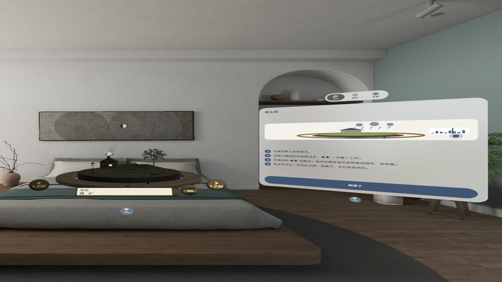
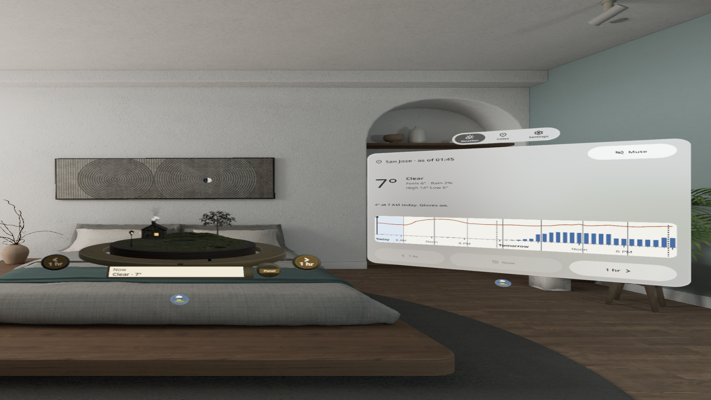
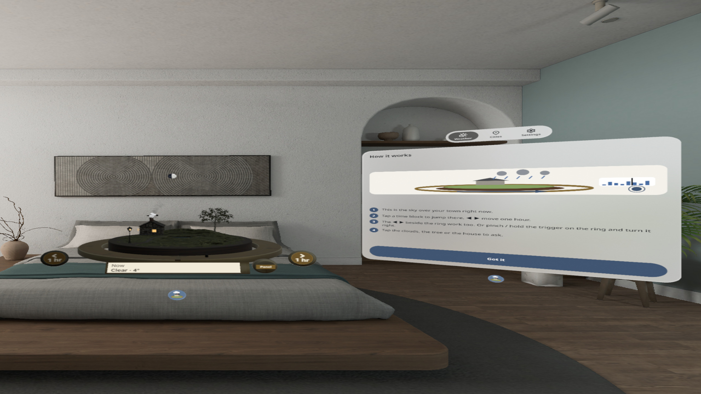
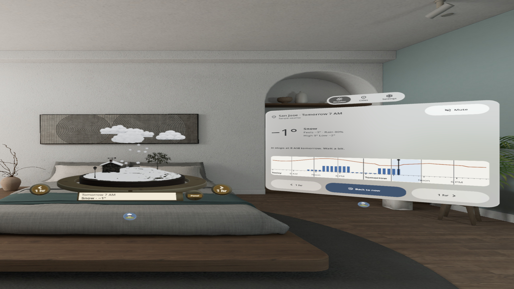
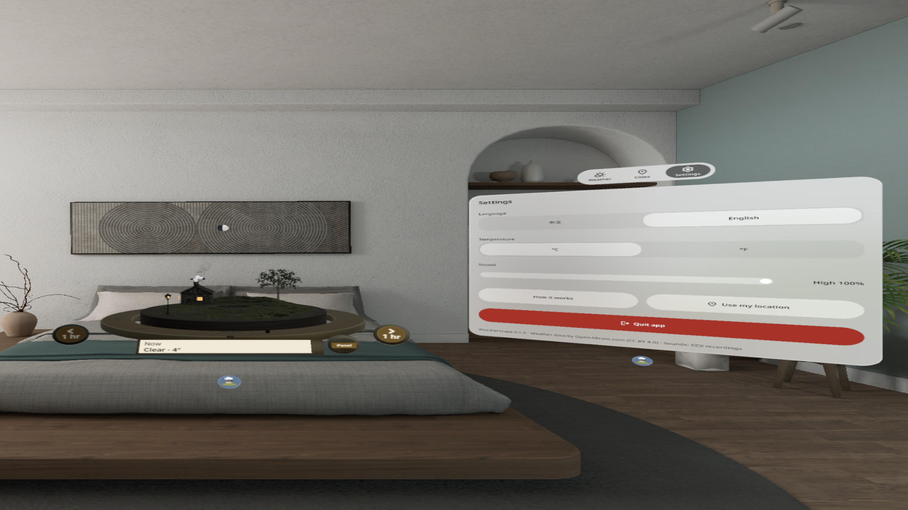

# 天气境 WeatherScape

**中文** · [English](#english)


桌上一座天气小景：拨一拨黄铜时间环，未来 48 小时的天就在小石屋上空演一遍。停下来，读数牌写着「明早 8 点 · 小雨 · 12°」，控制窗给一句：带不带伞、要不要加衣。

PICO OS 6 空间应用（Shared Space，Spatial SDK 6.1.9）。一个体积窗口放小景，右边一块控制窗（天气 / 城市 / 设置）。当前版本 **v0.1.6**：位置先问系统（拒绝才按 IP 猜，机房 / VPN 的 IP 直接丢掉，请你选城市），「现在」按气象服务器的时间、写成「<城市> · 观测 hh:mm」，不看头显时区。

- 捏住或扣扳机按住铜环左右拨，往右 = 更晚；松手带惯性，停在整点
- 环两边的 3D ◀ ▶ 铜钮：点一下走 1 小时，按住连跳
- 控制窗 8 个 6 小时时间块、[◀ 1 小时] [回到现在] [1 小时 ▶]，不拖也能到任何一小时
- 云、雨、雪、雾、雷、风（树摆、烟斜、风向标）、太阳月亮、昼夜、积雪都跟着那一小时变
- 点云、点树、点房子，小牌告诉你降水、风、体感
- 第一次打开问一次粗略位置；任意城市可搜（中文英文都行），最多存 3 个；设置里 [用我现在的位置] 随时重新定位；离线用缓存或内置示例天
- 中英双语即时切换，°C / °F，4 档声音，静音常显，设置里可直接退出应用

### 截图

| | |
|---|---|
|  此刻的天：表头「圣荷西 · 观测 01:30」是那座城市的当地时间，按气象服务器时钟走，不看头显时区 |  首次打开：控制窗「怎么玩」4 句 + 示意图 |
|  上午 11 点阴天，点云问一句：「降水 20% · 0 mm」，云不挡小牌 |  拨到明早 7 点：下雪 −1°，小岛和屋顶积白 |
| ![设置：语言、单位、4 档声音滑条、[用我现在的位置]、[退出应用]](docs/shot-06.jpg) 设置：语言、单位、4 档声音滑条、[用我现在的位置]、[退出应用] | |

截图来自 PICO 模拟器（v0.1.6，5120 × 2880 空间截图原生裁 16:9，调试命令驱动状态；除「此刻的天」外都是内置示例天的数据），**非真实手势录像 / 截图**。

### 安装

从 [Releases](https://github.com/kejing-dev/WeatherScape/releases) 下载 `WeatherScape-v0.1.6.apk`。它是 `assembleRelease` 出的**未签名**包（给应用商店托管签名用），直接装到设备前要自己签名，或者本地构建 debug 包：

```bash
adb install -r WeatherScape-v0.1.6.apk        # 已签名后
pico-cli app launch io.embodit.weatherscape
```

### 构建

```bash
export JAVA_HOME=<JDK 17+>
./gradlew assembleDebug :app:testDebugUnitTest   # 调试包 + 单测
./gradlew assembleRelease                         # 未签名 release 包
```

### 权限与网络

- 粗略位置（ACCESS_COARSE_LOCATION）：只用来找最近的城市；拒绝也能用，自己选城市即可
- 网络：Open-Meteo 预报；没有系统定位时按 IP 猜城市（ipapi.co → ipwho.is → ipinfo.io），系统定位的坐标用 BigDataCloud 反查城市名。都不用账号、不用 key

### 已知问题（v0.1.6）

- 权限框 60 秒没回答会按「不允许」处理；之后再点 [允许] 不会当场定位，要到设置里点 [用我现在的位置]。
- 离线时已经在「现在」，[回到现在] 仍是高亮。
- 冷启动加载模型较慢。

天气数据：Weather data by [Open-Meteo.com](https://open-meteo.com)（CC BY 4.0，免费层限非商业）。声音：CC0 录音（Kenney、freesound）。版本记录见 [CHANGELOG.md](CHANGELOG.md)。

## English


A weather diorama for your desk. Turn the brass ring and the next 48 hours play out over a little stone cottage: clouds,
rain, snow, fog, storms, wind and night. Stop anywhere and the readout says "Tomorrow 8 AM · Light rain · 54°" while the
control window tells you whether to grab an umbrella.

PICO OS 6 spatial app (Shared Space, Spatial SDK 6.1.9): one volume for the diorama, one control window on its right
(Weather / Cities / Settings). Current version **v0.1.6**: location asks the system first (IP only as a fallback, and
data-centre / VPN IPs are discarded so you pick a city instead); "now" follows the weather server's clock and reads
"<city> · as of hh:mm", independent of the headset's time zone.

- Pinch or hold the trigger on the brass ring and turn it; right = later. It coasts and stops on the hour.
- 3D ◀ ▶ brass buttons beside the ring: tap for one hour, hold to keep going.
- The control window has eight 6-hour blocks plus [◀ 1 hr] [Back to now] [1 hr ▶], so every hour is reachable without dragging.
- Tap the cloud, the tree or the house for rain chance, wind or feels-like.
- Approximate location once on first launch; search any city (Chinese or English), keep up to three; [Use my location] in Settings; offline it falls back to the cache or a built-in sample day.
- Chinese / English switch instantly, °C / °F, 4-step sound, always-visible mute, exit from Settings.

| | |
|---|---|
|  Right now: the header "San Jose · as of hh:mm" is the city's local time from the weather server, not the headset's time zone |  First launch: the How it works card |
|  11 AM overcast, tap the cloud: rain chance and amount |  Tomorrow 7 AM: snow at −1°, the island turns white |
|  Settings: language, units, 4-step sound slider, [Use my location], [Exit app] | |

Screenshots come from the PICO emulator (v0.1.6, native 16:9 crops of 5120 × 2880 spatial captures, states driven by
debug commands; all but "Right now" use the built-in sample day), **not real hand-gesture footage**.

**Install:** download `WeatherScape-v0.1.6.apk` from Releases. It is the **unsigned** `assembleRelease` build (for store
signing); sign it yourself before `adb install -r WeatherScape-v0.1.6.apk`, or build the debug APK, then
`pico-cli app launch io.embodit.weatherscape`.

**Permissions and network:** approximate location (only to find the nearest city; deny it and pick a city yourself);
Open-Meteo forecasts; IP lookup (ipapi.co → ipwho.is → ipinfo.io) only when system location is unavailable; BigDataCloud
reverse geocoding for the system fix. No accounts, no keys.

**Known issues (v0.1.6):** if the permission dialog goes unanswered for 60 s it counts as denied, and tapping [Allow]
later does not locate right away — use [Use my location] in Settings; offline, [Back to now] stays highlighted even at
"now"; models load slowly on a cold start.

Weather data by Open-Meteo.com (CC BY 4.0). Sounds: CC0 recordings. See [CHANGELOG.md](CHANGELOG.md).
