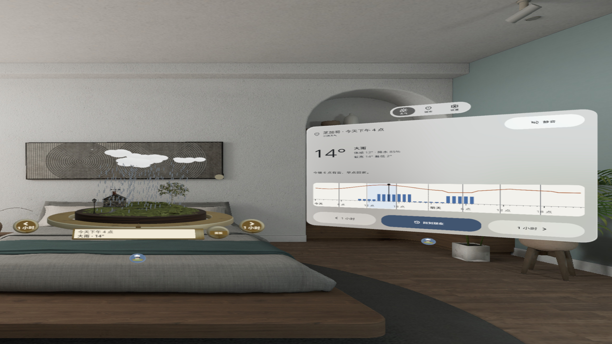
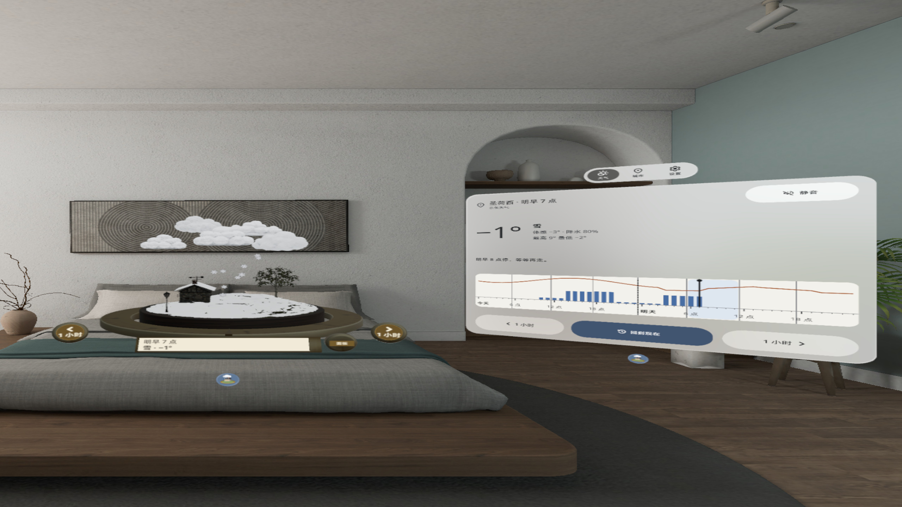
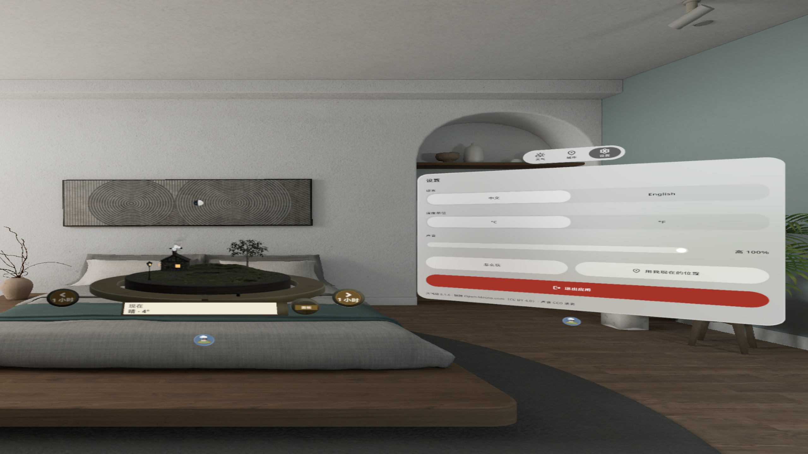
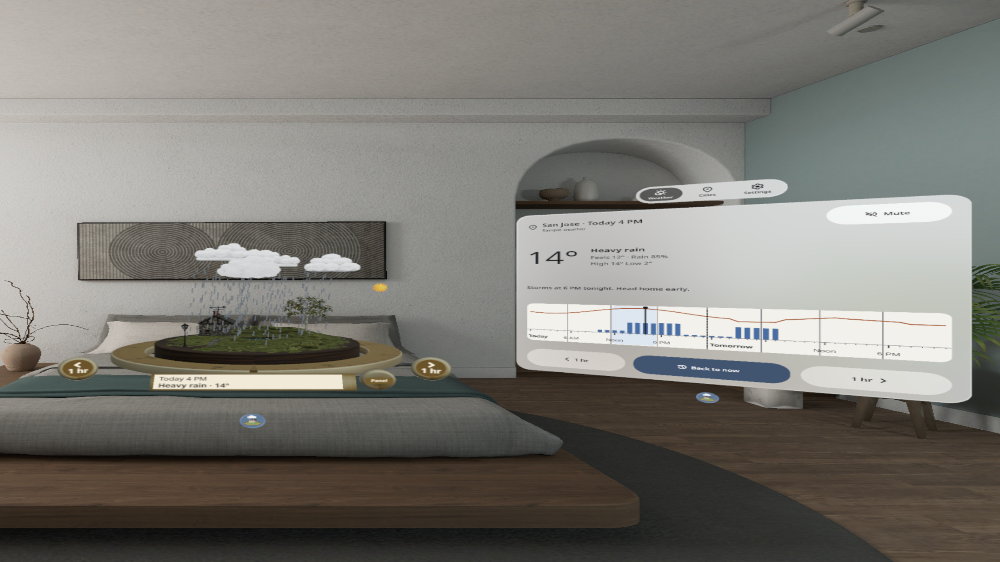

# 天气境 WeatherScape

**中文** · [English](#english)



桌上一座天气小景：拨一拨黄铜时间环，未来 48 小时的天就在小石屋上空演一遍。停下来，读数牌写着「明早 8 点 · 小雨 · 12°」，控制窗给一句：带不带伞、要不要加衣。

PICO OS 6 空间应用（Shared Space，Spatial SDK 6.1.9）。一个体积窗口放小景，右边一块控制窗（天气 / 城市 / 设置）。当前版本 **v0.1.4**（太阳 / 月亮 / 云 / 烟换 Tripo 模型、雪花六角结晶）。

- 捏住或扣扳机按住铜环左右拨，往右 = 更晚；松手带惯性，停在整点
- 环两边的 3D ◀ ▶ 铜钮：点一下走 1 小时，按住连跳
- 控制窗 8 个 6 小时时间块、[◀ 1 小时] [回到现在] [1 小时 ▶]，不拖也能到任何一小时
- 云、雨、雪、雾、雷、风（树摆、烟斜、风向标）、昼夜、积雪都跟着那一小时变
- 点云、点树、点房子，小牌告诉你降水、风、体感
- 任意城市可搜（中文英文都行），最多存 3 个；离线用缓存或内置示例天
- 中英双语即时切换，°C / °F，静音常显，设置里可直接退出应用

### 截图

| | |
|---|---|
|  首次打开：怎么玩 4 句 |  上午 11 点阴天，点云问一句：降水 20% · 0 mm |
|  明早 7 点下雪，岛上和屋顶积白 |  下雨时点房子：体感温度 |
|  搜城市：中文界面搜 London，第一条就是伦敦 |  英文界面 |

截图来自 PICO 模拟器（v0.1.3，调试命令驱动状态），**非真实手势录像 / 截图**；画面按 5120 × 2880 空间截图裁成 16:9。

### 安装

从 [Releases](https://github.com/kejing-dev/WeatherScape/releases) 下载 `WeatherScape-v0.1.3.apk`。它是 `assembleRelease` 出的**未签名**包（给应用商店托管签名用），直接装到设备前要自己签名，或者本地构建 debug 包：

```bash
adb install -r WeatherScape-v0.1.3.apk        # 已签名后
pico-cli app launch io.embodit.weatherscape
```

### 构建

```bash
export JAVA_HOME=<JDK 17+>
./gradlew assembleDebug :app:testDebugUnitTest   # 调试包 + 78 条单测
./gradlew assembleRelease                         # 未签名 release 包
```

### 已知问题（v0.1.3）

- 环面上的小时刻度和日名在近乎平视时不好读；同一时间在读数牌和控制窗上都有。
- 控制窗的 ▶ 长按 2 秒松手时会多走 1 小时（3D ◀ ▶ 没有这个问题）。
- 小景放大后的大小、白云亮度、3D 钮的手感还等真机确认。

天气数据：Weather data by [Open-Meteo.com](https://open-meteo.com)（CC BY 4.0，免费层限非商业）。声音：CC0 录音（Kenney、freesound）。版本记录见 [CHANGELOG.md](CHANGELOG.md)。

## English


A weather diorama for your desk. Turn the brass ring and the next 48 hours play out over a little stone cottage: clouds,
rain, snow, fog, storms, wind and night. Stop anywhere and the readout says "Tomorrow 8 AM · Light rain · 54°" while the
control window tells you whether to grab an umbrella.

PICO OS 6 spatial app (Shared Space, Spatial SDK 6.1.9): one volume for the diorama, one control window on its right
(Weather / Cities / Settings). Current version **v0.1.3**.

- Pinch or hold the trigger on the brass ring and turn it; right = later. It coasts and stops on the hour.
- 3D ◀ ▶ brass buttons beside the ring: tap for one hour, hold to keep going.
- The control window has eight 6-hour blocks plus [◀ 1 hr] [Back to now] [1 hr ▶], so every hour is reachable without dragging.
- Tap the cloud, the tree or the house for rain chance, wind or feels-like.
- Search any city (Chinese or English), keep up to three; offline it falls back to the cache or a built-in sample day.
- Chinese / English switch instantly, °C / °F, always-visible mute, exit from Settings.

Screenshots come from the PICO emulator (v0.1.3, states driven by debug commands), **not real hand-gesture footage**.

**Install:** download `WeatherScape-v0.1.3.apk` from Releases. It is the **unsigned** `assembleRelease` build (for store
signing); sign it yourself before `adb install -r WeatherScape-v0.1.3.apk`, or build the debug APK, then
`pico-cli app launch io.embodit.weatherscape`.

**Known issues (v0.1.3):** hour ticks on the ring are hard to read at a flat viewing angle (the readout and the window
show the same time); holding the window's ▶ for 2 s adds one extra hour on release (the 3D buttons don't).

Weather data by Open-Meteo.com (CC BY 4.0). Sounds: CC0 recordings. See [CHANGELOG.md](CHANGELOG.md).
